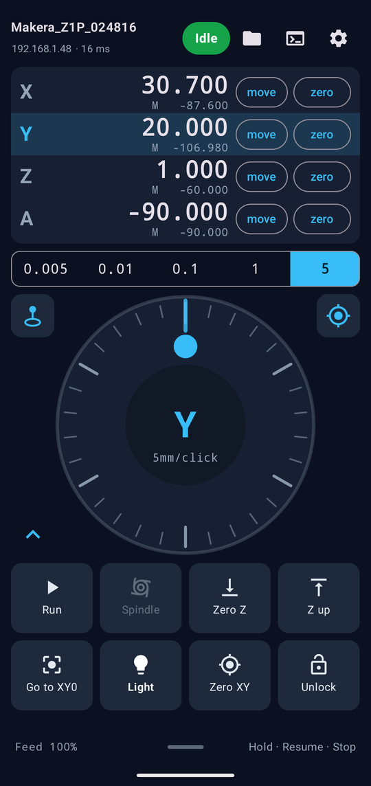
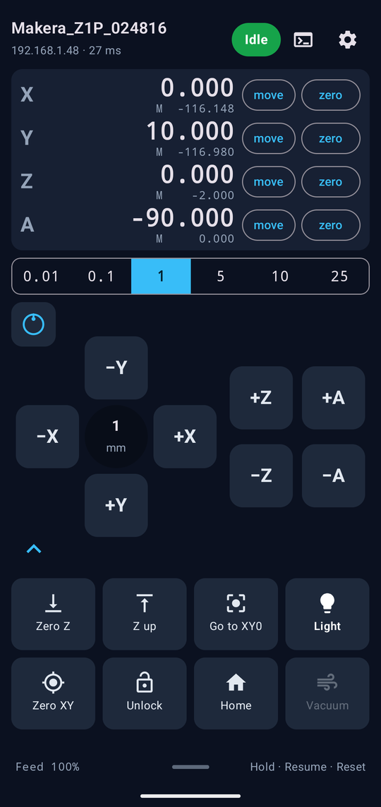
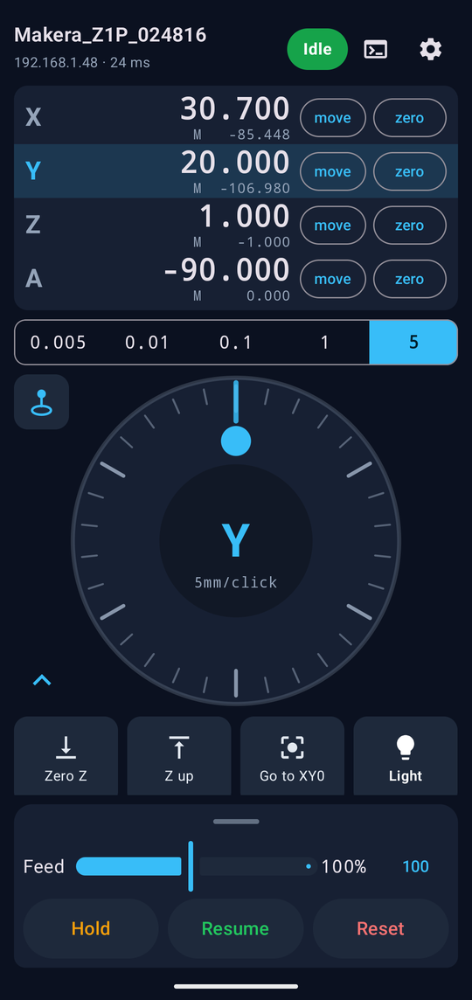
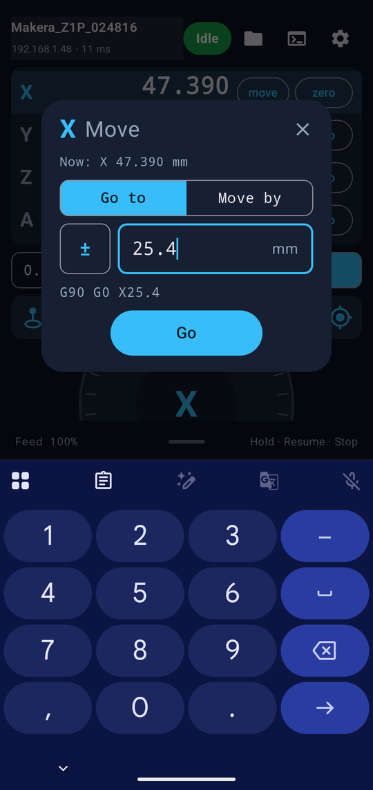
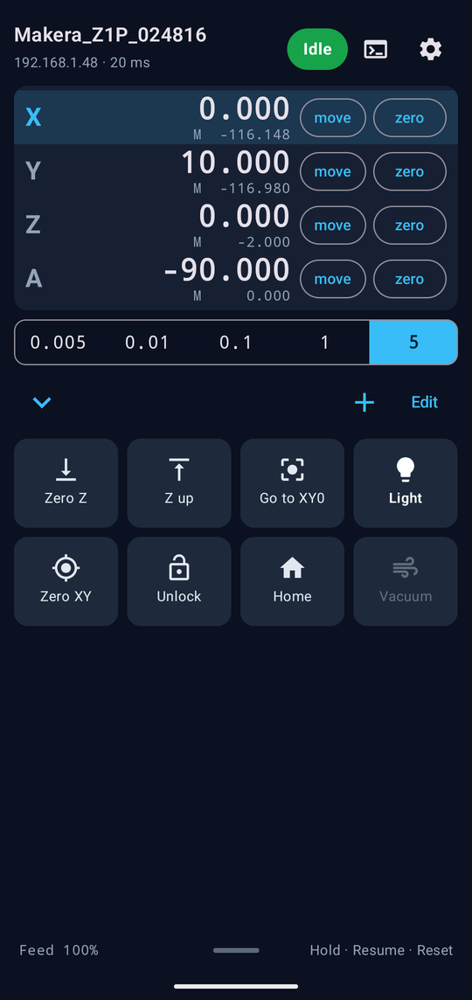
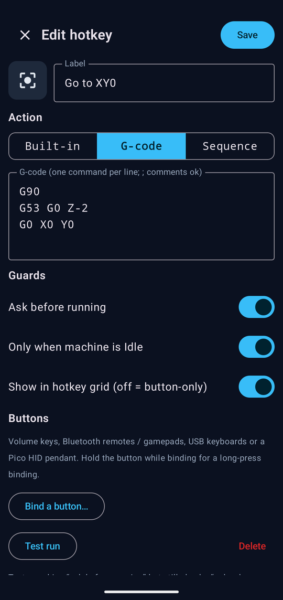
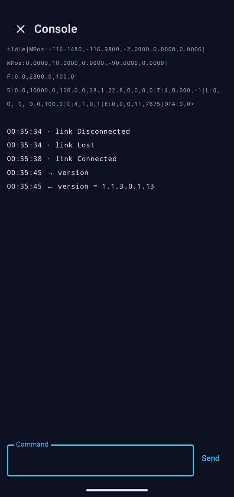
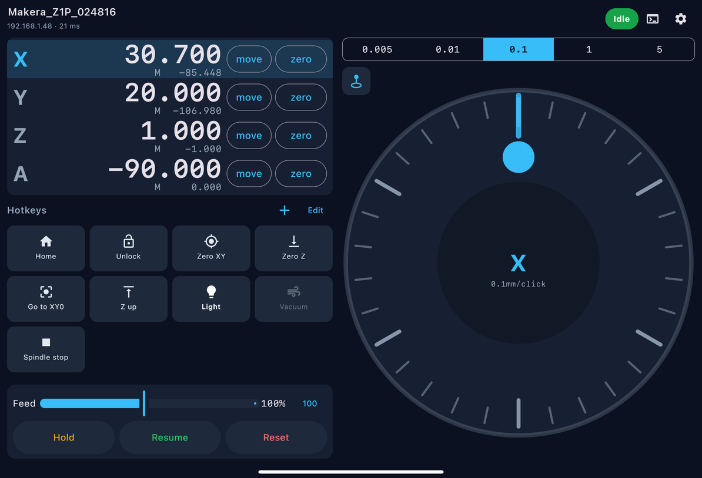
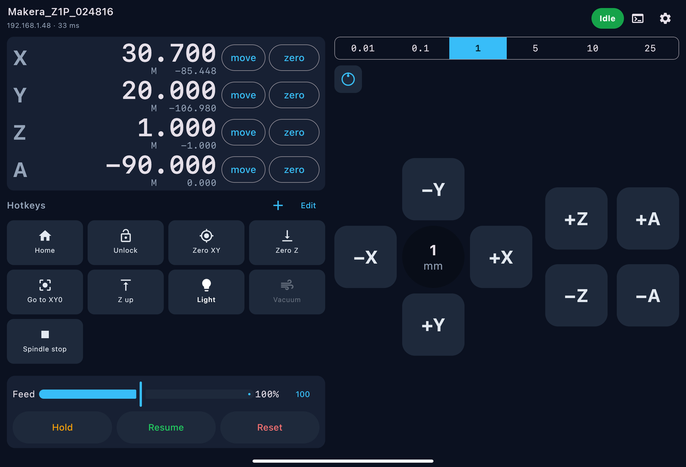
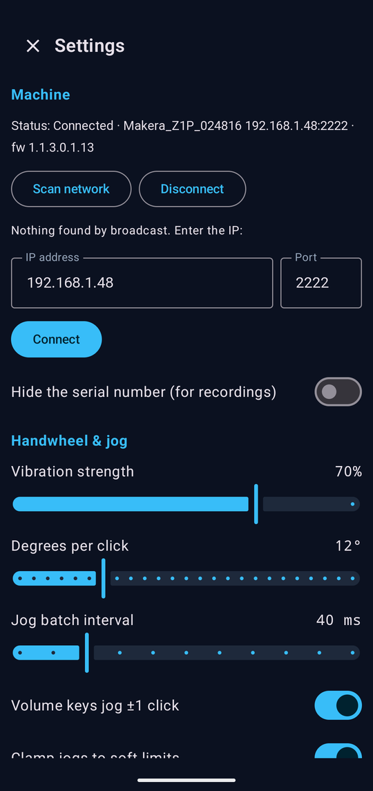

# Z1 Pendant

A wireless jog pendant for the **Makera Z1** CNC, for Android and iPhone. Turn a handwheel on your phone,
tap a jog pad, run your own hotkeys, and see live positions, all over Wi-Fi with the machine on its
**stock firmware**. Nothing on the machine is changed or installed.

<p align="center">
  
  
  
</p>

> **Not affiliated with Makera.** This is an independent, community project. It moves a real machine:
> keep your hand near the machine's own stop button, and use it at your own risk.

## Features
- **Handwheel**: drag around the dial; every click (12° by default) moves one step, with a vibration
  "detent" you can feel. The wheel turns in whole clicks under a fixed marker.
- **Jog pad**: tap the joystick button to swap the dial for a −X/+X/−Y/+Y pad with Z and A up/down.
  Tap for one step, hold to keep moving; it stops when you let go.
- **Step sizes**: 0.005 · 0.01 · 0.1 · 1 · 5 mm on the dial; 0.01 · 0.1 · 1 · 5 · 10 · 25 mm on the pad.
  Each mode remembers its own step.
- **Live readout**: work position (large) and machine position (small) for X, Y, Z and A.
  - **move**: type a position (*Go to*) or a distance (*Move by*) and send it, with the exact G-code shown first.
  - **zero**: set the axis to 0. Press again before moving (it reads **undo**) to get the old value back,
    like a DRO's zero/recall.
- **Hotkeys**: your own buttons for built-in actions (home, unlock, zero, light, vacuum, feed…),
  G-code, or multi-step sequences. Optional "ask before running" and "only when Idle" guards.
  Bind any hotkey to a physical button: volume keys, Bluetooth remotes and gamepads, USB keyboards.
  Import/export the whole set as a file.
- **Feed override, Hold, Resume, Reset** in a drawer at the bottom (swipe up). It opens by itself
  when the machine holds, alarms, or starts moving from somewhere else (e.g. a job from Makera Studio).
  The buttons stay quiet while idle and light up when they matter: Hold and Reset while moving,
  Resume on hold, Reset in an alarm.
- **Tablets** (iPad, Android tablets): a bigger readout, and the dial / jog pad resize around your
  hotkeys. Turn the tablet sideways for a side-by-side layout with everything on screen at once:
  readout, hotkeys and the stop buttons on the left, steps and a big dial or jog pad on the right.
- **Soft-limit protection**: jogs are clamped and typed moves refused before they reach the
  machine's soft limits, so they don't trip an alarm.
- **Console**: every command sent and every reply, with time stamps, plus a box to type commands.
- **Toggles that show state**: the Light and Vacuum tiles are bright when on, dim when off (read back
  from the machine).
- **Spindle**: the Spindle tile is dim while off; tap it for the start box (always asks): pick a preset
  (up to the Z1's 13,000 RPM max) or type an RPM. It remembers the last one. While it runs, the tile
  turns blue and shows the live RPM; one tap stops it. It refuses to start with no tool loaded (the
  firmware would halt the machine).
- Works alongside Makera Studio: both can be connected at the same time.

<p align="center">
  
  
  
  
</p>

<p align="center">
  
  
</p>

## Requirements
- An Android phone or tablet on **Android 12 or newer** (developed on a Pixel 10, Android 16), or an
  **iPhone / iPad on iOS 16 or newer** that you build and install yourself from a Mac (see
  [iPhone](#iphone); tested on an iPhone 16 with iOS 27 and an iPad Pro 11" with iPadOS 18).
- A **Makera Z1** (developed on a Z1 Pro) on stock firmware, already set up on your Wi-Fi with the
  Makera app.
- Phone and machine on the **same Wi-Fi network**.

## Install (Android)
The app isn't on the Play Store, so you install the APK file yourself ("sideloading"). It only takes a minute.

1. **Download the APK** on your phone: open the [latest release](../../releases/latest) and tap
   `z1-pendant-<version>.apk` under **Assets**.
2. **Open the downloaded file**: tap the download notification, or find it in **Files → Downloads**.
3. **Allow the install.** The first time, Android says your browser (or Files) isn't allowed to install
   apps. Tap **Settings**, turn on **Allow from this source**, then go back.
4. Tap **Install**. If Google Play Protect says the app is unknown, tap **More details → Install anyway**
   (it's unknown only because it isn't from the Play Store).
5. Open **Z1 Pendant**. No permissions to grant: everything it needs is allowed at install.

**Updating:** install the newer APK the same way; your hotkeys and settings are kept.
**Removing:** long-press the app icon → **Uninstall**.

> Prefer installing from a computer? With [adb](https://developer.android.com/tools/adb) and USB
> debugging on: `adb install z1-pendant-<version>.apk`.

## iPhone
There's no App Store version, so you build the app on a Mac and install it on your iPhone with your
own (free) Apple ID. It's the same app and the same screens as on Android.

The same steps install it on an iPad. You need a Mac with **Xcode** (free, Mac App Store) and **Java 21** (e.g. [Temurin](https://adoptium.net)),
and a USB cable for the first install.

1. Get the source: `git clone https://github.com/jimmyvegas29/makera-z1-pendant`
2. In Xcode: **Settings → Accounts → +** → sign in with your Apple ID. A free one works.
3. Plug in the iPhone, tap **Trust**, and turn on **Settings → Privacy & Security → Developer Mode**
   (the phone restarts).
4. Open `ios/iosApp.xcodeproj` in Xcode once: target **iosApp → Signing & Capabilities → Team** →
   your **(Personal Team)**. Note the 10-character team ID (`security find-identity -v -p codesigning`
   shows it in brackets).
5. Build and install: `ios/build_and_install.sh <TEAM_ID>`. (Or press ▶ in Xcode with the iPhone selected.)
6. On the iPhone: **Settings → General → VPN & Device Management** → your Apple ID → **Trust**.
7. Open **Z1 Pendant** and tap **Allow** when it asks to find devices on your local network.

With a **free Apple ID the app stops opening after 7 days**: plug the phone in and run step 5 again
(your settings and hotkeys are kept). A paid Apple Developer account makes it a year.

Differences on iPhone: the volume buttons can't jog (iOS doesn't let apps use them), and hotkey
export/import is Android-only for now. **Scan network** works once you've allowed local network access.

## Connect to your machine
1. Turn the Z1 on and let it finish homing.
2. In the app, tap the **⚙ settings** icon (top right) → **Scan network**. Your machine appears as
   `Makera_Z1P_…`; tap it.
3. If it isn't found (some routers block broadcasts; on iPhone, check local network access is allowed
   under Settings → Privacy & Security → Local Network), type the machine's IP address and tap **Connect**.
   The IP is in the Makera app or your router's device list. The port is 2222.

The app remembers the machine and reconnects by itself. The name, IP and round-trip time show at the
top; the pill shows the machine state (Idle, Run, Hold, Alarm…).

<p align="center"></p>

## Using it
**Readout**
- Tap an axis row to pick it for the dial (it highlights). Hold a row for 1.5 s, or tap **move**, to type a move.
- **zero** sets that axis's work position to 0; **undo** puts it back if nothing has moved since.

**Dial**
- Drag your finger around the ring. Clockwise is +, counter-clockwise is −. Speed follows your hand.
- Volume keys jog ±1 click on the selected axis (can be turned off in Settings).

**Jog pad**
- Tap the joystick button (top-left of the dial). Tap the dial icon in the same spot to go back.
- Tap a button for one step; hold it to keep moving.

**Hotkeys**
- Tap a tile to run it. Hold a tile for 2 s to edit it.
- The **⌃** chevron (bottom-left of the dial) shows every hotkey. There, **+** adds one and **Edit**
  lets you drag tiles into a new order; tap **Save** when done. Hotkeys you've hidden from the grid
  (button-only) always sort after the visible ones.
- In the editor: pick a built-in action, write G-code (one command per line), or build a sequence
  (G-code, wait until Idle, delay, run another hotkey). **Bind a button…** then press any button on
  your phone, remote or gamepad. **Test run** tries it out.

**Bottom drawer**
- Swipe up on the handle at the bottom for Feed override, **Hold**, **Resume** and **Reset**.

**Console** (icon next to the state pill)
- Shows what was sent (→), the machine's replies (←), hotkeys run (▶) and a one-line summary of each
  jog. Type any command at the bottom.

**Settings**
- Machine connection, vibration strength, degrees per click, volume-key jogging, soft-limit clamping,
  keep screen on, and hotkey export/import/reset.
- No vibration from the dial? The phone's **Use vibration & haptics** must be on (Settings → Sound &
  vibration → Vibration & haptics). **Touch feedback** can stay off on Android 13 and newer.

## Build from source
The full source is here. Make it your own.

- **App** (`android/`): Kotlin + Compose Multiplatform. Almost everything (UI, jog engine, protocol)
  lives in `android/shared` and runs on both platforms; `android/app` is the Android shell and `ios/`
  the iPhone shell (see [iPhone](#iphone)). Open `android/` in Android Studio, or with JDK 21 and the
  Android SDK installed:
  ```bash
  cd android
  ./gradlew assembleRelease        # Windows: gradlew.bat assembleRelease
  ```
  The APK lands in `android/app/build/outputs/apk/release/`. Builds are signed with your local debug
  key, so an APK you build can't update one installed from the releases page (uninstall that first).
- **Python tools** (`python/`, Python 3, no extra packages):
  - `z1sim.py`: a machine simulator. Point the app at your computer's IP to try everything with no machine.
  - `z1client.py`: a command-line client (discover, read status, send a line).
  - `z1proto.py`: the protocol code, with a self-test.

How it works under the hood (protocol, jog engine, what's been confirmed on a real Z1):
[docs/DEVELOPMENT.md](docs/DEVELOPMENT.md).

## License
[MIT](LICENSE): use it, change it, share it, even sell it. Just keep the copyright notice and
license with it, so the original work gets credit.
